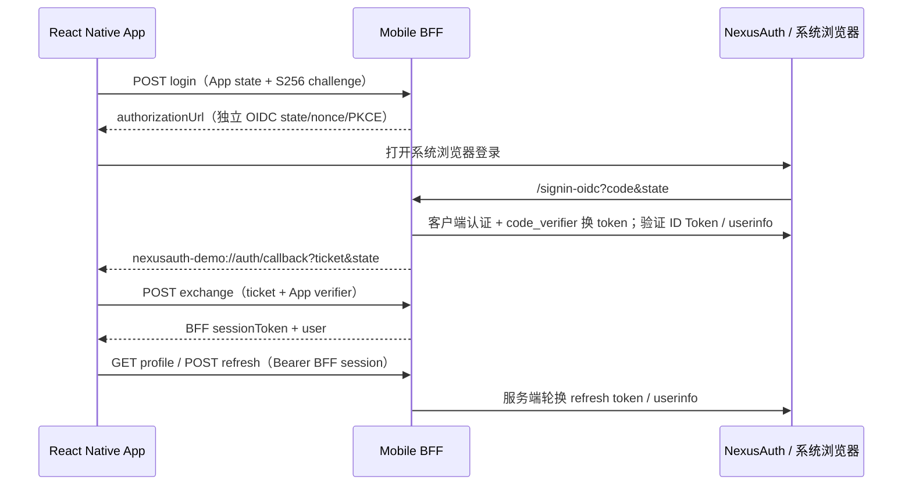

# NexusAuth 移动端登录后端

配合 `../Demo.Mobile` 的 React Native / Expo iOS、Android App。NexusAuth 当前只支持 confidential client，不能把 client secret 放进安装包；此后端作为移动端 BFF 执行标准 OIDC Authorization Code + S256 PKCE。App 使用独立的不透明会话凭据调用业务接口。

## 本机快速运行（iOS 模拟器）

1. 仓库根目录启动已有 Provider：`docker compose up -d --build`。
2. 只登记移动客户端，不修改现有管理员或 Web demo（本地演示密钥自行替换）：

```bash
docker compose exec -T db psql -U nexusauth -d nexusauth -v ON_ERROR_STOP=1 \
  -v mobile_secret='local-mobile-demo-only' \
  -v mobile_redirect='http://localhost:5401/signin-oidc' < demo/mobile-seed.sql
```

3. 在仓库根目录启动后端：

```bash
NexusAuth__ClientSecret=local-mobile-demo-only \
  dotnet run --project demo/src/Demo.Mobile.Backend
```

4. 根据 `../Demo.Mobile/README.md` 构建 App。登录可用现有 Provider 用户，默认本地管理员 `admin / wzw0126..`（已有账号保留原密码）。也可导入 `demo/seed.sql` 使用 `alice / Pass@123`，但全量 seed 会更新 demo 用户密码；仅试移动端建议用 `mobile-seed.sql`。

## Android 模拟器和真机

手机/Android 模拟器的 `localhost` 是手机自身；Provider 的 authorization URL 和 BFF HTTPS 回调必须在手机浏览器能访问，后端也必须能访问 discovery、token 和 JWKS。请统一使用电脑局域网 IP 或开发 HTTPS 域名。不要仅改 App API 地址：Provider 的 issuer、BFF Authority、客户端 redirect_uri 也要一起改。

以电脑 IP `192.168.1.20` 为例：

- Provider issuer 改为 `http://192.168.1.20:5100`。根 Compose 使用 `NEXUSAUTH_JWT_ISSUER`，必须重建/重启 Provider 使配置生效。
- 当前 Compose SSO 端口仅绑定 `127.0.0.1`；通过仅用于本地开发的 Compose override 把 `sso.ports` 替换为 `5100:8080`，不要对外公开数据库端口。Docker Compose 2.24.4+ 可用 `ports: !override ["5100:8080"]`。检查防火墙和同一 Wi-Fi。
- LAN HTTP 无法用现有 localhost Passkey RP ID；本地移动演示采用密码登录，必要时在该开发 Provider 设置 `NEXUSAUTH_WEBAUTHN_ENABLED=false`。生产使用 HTTPS 和正确的 RP ID/Origin。
- `mobile-seed.sql` 的 `mobile_redirect` 设为 `http://192.168.1.20:5401/signin-oidc`。
- 启动移动 BFF：

```bash
NexusAuth__Authority=http://192.168.1.20:5100 \
NexusAuth__RedirectUri=http://192.168.1.20:5401/signin-oidc \
NexusAuth__ClientSecret=local-mobile-demo-only \
  dotnet run --project demo/src/Demo.Mobile.Backend --urls http://0.0.0.0:5401
```

- App `.env`：`EXPO_PUBLIC_MOBILE_API_URL=http://192.168.1.20:5401`。Android 模拟器单独访问后端可用 `10.0.2.2`，但浏览器授权与回调仍需使用已登记且能访问的公共地址。
- iOS HTTP 开发例外、Android cleartext 开发设置在 App 原生配置中；上生产应移除，改 HTTPS。

也可在 Dashboard 手动登记：client ID `demo-mobile-bff`、认证 `client_secret_basic`、grant `authorization_code`/`refresh_token`、scope `openid profile email offline_access`、强制 PKCE、精确 HTTP(S) 后端回调；不是登记 `nexusauth-demo://...`，它仅由 BFF 用于返回 App。

## 流程与接口



- `POST /api/mobile/login`：`{challenge,state}`，均为 32-byte Base64Url 对应的 43 字符。flow 5 分钟过期。
- `GET /signin-oidc`：校验 state、授权码 PKCE、ID Token 签名/RS256/issuer/audience/时效/nonce、userinfo sub。错误只返回固定的 `login_failed`。
- `POST /api/mobile/exchange`：`{ticket,verifier}`。ticket 60 秒有效，必须匹配 App 的 S256 challenge，一次消费。自定义 scheme 被其他 App 抢占时，持有 ticket 仍不能兑换会话。
- `GET /api/mobile/profile`：用 `Authorization: Bearer <sessionToken>`。到期前 30 秒自动刷新，每次读取 Provider userinfo。响应 `{user,expiresAt,refreshed}`。
- `POST /api/mobile/refresh`：同一 Bearer 会话，手动轮换 refresh token。
- `POST /api/mobile/logout`：本地会话立即失效，再撤销 access/refresh token，响应 `{revoked}`。`revoked=false` 表示 Provider 未确认撤销；App 仍清除本地凭据。
- `GET /health`：就绪探测，不包含凭据。

会话固定 8 小时；到期、refresh 拒绝或用户失效返回 401，App 清除会话并重新登录。Provider 暂时不可用返回 502，保留会话让用户重试。App 的 SecureStore 仅保存 BFF session token，OAuth token 不发往 App。

退出仅退出该 App，不结束系统浏览器中的 NexusAuth SSO Cookie。再次登录可能无需输密码，这正是 SSO 的效果。不同平台和浏览器的 Cookie 共享行为有差异，不保证与 Safari/Chrome 所有普通标签页共享。全局退出要另行通过系统浏览器走 `/connect/endsession` 的用户确认流程；不能由 API 静默假装删除浏览器 Cookie。

## 验证与生产边界

```bash
dotnet build demo/src/Demo.Mobile.Backend
dotnet test demo/tests/Demo.Mobile.Backend.Tests
```

测试以真实 RSA 签名的模拟 OIDC Provider 验证完整协议和失败路径。上线还需要：HTTPS、唯一 bundle ID/scheme 或经过关联验证的 Universal/App Links、秘密管理、请求日志脱敏、共享 TTL 存储与分布式原子消费/刷新锁、过期/取消登录产生的孤立授权清理。当前内存存储重启会注销所有 App，会话失效后令牌靠 Provider 自身时效到期；这套实现是可运行单实例 demo。反向代理不要记录含授权码/ticket 的查询参数，不要给 token endpoint 启用请求体日志。App 持有的 session token 同样属于敏感 Bearer 凭据。

小程序需要平台特定登录和 HTTPS 回调桥接，不能直接使用这里的 iOS/Android 自定义 scheme。
