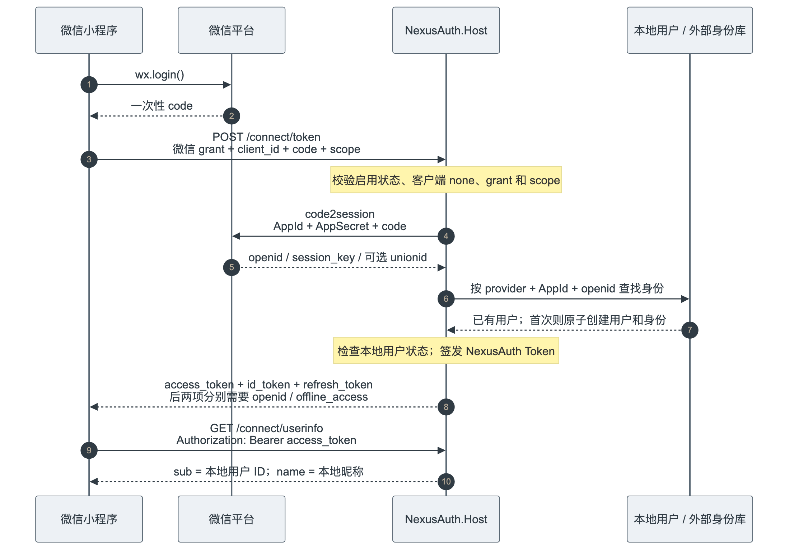
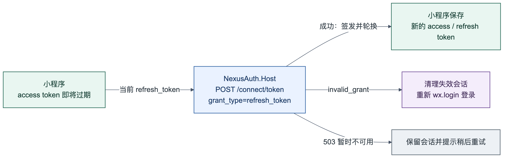

# 微信小程序接入

本文说明微信小程序如何用 `wx.login` 的一次性 `code` 登录 NexusAuth，并复用 NexusAuth 现有的 token、refresh token 和 UserInfo 端点。小程序是 OAuth 公共客户端，小程序侧只持有 `client_id`，不保存 `client_secret`。

## 1. 接入模型

| 项目 | 值 |
| --- | --- |
| Token 端点 | `POST /connect/token` |
| Grant type | `urn:nexusauth:grant-type:wechat_miniprogram` |
| `client_id` | 默认 `wechat-miniapp`，必须与 Host 配置和客户端记录一致 |
| 客户端类型 | 公共客户端，`token_endpoint_auth_method=none` |
| 允许的 grant | 仅微信扩展 grant 和 `refresh_token` |
| 微信身份 | `provider=wechat_miniprogram`、`issuer=AppId`、`subject=openid` |
| NexusAuth 用户 | 首次登录自动创建本地用户；后续按同一 `provider + issuer + subject` 登录同一本地用户 |

完整链路如下：



图中是当前已实现的小程序直连 Host 流程，不经过业务 BFF。`session_key` 只由微信返回给 Host，不返回小程序；`unionid` 不用于自动合并账号。图中的 code2session 是微信接口，微信请求内的 `grant_type=authorization_code` 不等于小程序提交给 NexusAuth 的微信扩展 grant。

可直接导入微信开发者工具的原生小程序示例见 [最小登录示例](examples/wechat-miniprogram/README.md)。替换 AppID 和配置、完成下文服务端与域名设置后，即可验证登录、UserInfo 和刷新。

1. 小程序调用 `wx.login()`，取得短时、一次性的 `code`。
2. 小程序把 `code`、固定 `client_id` 和所需 `scope` 表单提交到 NexusAuth `/connect/token`。
3. NexusAuth Host 在服务端使用小程序 `AppId` 和 `AppSecret` 调用微信 `code2session`，取得 `openid`，必要时取得 `unionid`。
4. Host 按 `provider=wechat_miniprogram`、`issuer=AppId`、`subject=openid` 查找外部身份，首次登录时创建本地用户。
5. Host 复用现有令牌服务签发 NexusAuth access token、ID Token 和 refresh token。
6. 小程序使用 access token 调用 `/connect/userinfo` 或已授权的业务 API。

需要特别区分两套身份标识：

- 微信侧的登录主体是 `openid`，外部身份记录中同时保存 `AppId` 作为 issuer。
- NexusAuth token 和 UserInfo 中的 `sub` 是本地用户 UUID，不是 `openid`。
- `unionid` 只作为外部身份元数据保存，当前不按 UnionID、昵称、头像或手机号自动合并账号。

## 2. 配置 Host

在 NexusAuth.Host 的服务端环境中配置：

| 环境变量 | 是否必填 | 说明 |
| --- | --- | --- |
| `NEXUSAUTH_WECHAT_MINIPROGRAM_ENABLED` | 是 | 设为 `true` 才开放微信小程序 grant |
| `NEXUSAUTH_WECHAT_MINIPROGRAM_CLIENT_ID` | 启用时必填 | 默认 `wechat-miniapp`，必须与数据库客户端 `client_id` 完全一致 |
| `NEXUSAUTH_WECHAT_MINIPROGRAM_APP_ID` | 启用时必填 | 微信小程序 AppID，同时作为外部身份的 `issuer` |
| `NEXUSAUTH_WECHAT_MINIPROGRAM_APP_SECRET` | 启用时必填 | 微信小程序 AppSecret，只放在 Host 服务端 |
| `NEXUSAUTH_WECHAT_MINIPROGRAM_CODE2SESSION_ENDPOINT` | 否 | 默认使用微信 `code2session` 地址；仅受控测试或代理环境需要覆盖，必须是 HTTPS URL |

示例：

```bash
NEXUSAUTH_WECHAT_MINIPROGRAM_ENABLED=true
NEXUSAUTH_WECHAT_MINIPROGRAM_CLIENT_ID=wechat-miniapp
NEXUSAUTH_WECHAT_MINIPROGRAM_APP_ID=wx_your_app_id
NEXUSAUTH_WECHAT_MINIPROGRAM_APP_SECRET=replace_with_server_secret
```

配置要求：

- `AppSecret` 通过环境变量、Secret Manager 或部署平台密钥注入，不写进源码、小程序包、前端配置或日志。
- 不要把 `AppId`、`AppSecret` 的微信控制台配置与 NexusAuth `client_id` 混用。`AppId` 用于访问微信接口，`client_id` 用于访问 NexusAuth token 端点。
- 修改 `AppId` 会让新的外部身份使用新的 issuer，旧账号不会被自动关联；生产切换前应评估数据迁移。
- 修改 `AppSecret` 只需同步 Host 配置并重启，不应暴露给小程序。

## 3. 注册公共客户端

### 3.1 需要的数据库值

客户端保存在 `nexusauth.oauth_clients`。小程序客户端应满足：

| 字段 | 值 |
| --- | --- |
| `client_id` | `wechat-miniapp`，或与 `WeChat:MiniProgram:ClientId` 相同的其他稳定值 |
| `client_name` | 例如 `微信小程序` |
| `token_endpoint_auth_method` | `none` |
| `allowed_grant_types` | 仅 `urn:nexusauth:grant-type:wechat_miniprogram` 和 `refresh_token` |
| `allowed_scopes` | `openid profile offline_access`，以及明确授权的业务 API scope |
| `redirect_uris` | `[]` |
| `post_logout_redirect_uris` | `[]` |
| `require_pkce` | `false`；该扩展 grant 不使用授权码和 PKCE |
| `is_active` | `true` |
| `jwks`、`jwks_uri` | `null` |

该客户端不能有 `nexusauth.oauth_client_secrets` 记录，也不能配置 JWKS。业务 API scope 来自已启用的 API resource；需要在 `nexusauth.client_api_resources` 中把客户端与对应 resource 关联，并让 `allowed_scopes` 包含 resource 的 audience。

### 3.2 通过 Workbench API 注册

当前客户端元数据已经包含公共客户端 `none` 和微信小程序 grant。使用已登录的 Workbench 会话，调用：

```http
POST /api/clients
Content-Type: application/json
```

请求体示例：

```json
{
  "clientId": "wechat-miniapp",
  "clientName": "微信小程序",
  "description": "微信 wx.login 公共服务",
  "redirectUris": [],
  "postLogoutRedirectUris": [],
  "allowedScopes": [
    "openid",
    "profile",
    "offline_access"
  ],
  "allowedGrantTypes": [
    "urn:nexusauth:grant-type:wechat_miniprogram",
    "refresh_token"
  ],
  "requirePkce": false,
  "tokenEndpointAuthMethod": "none",
  "autoGenerateJwks": false,
  "jwks": null,
  "jwksUri": null,
  "apiResourceIds": []
}
```

需要访问业务 API 时，把已启用的 API resource 的 audience 加入 `allowedScopes`，并把对应 resource ID 加入 `apiResourceIds`；有多个资源时逐一加入。创建后确认响应中的客户端确实为 `none`，并且没有生成 secret、私钥或 JWKS。

也可以在 Dashboard 的客户端管理页面新建客户端：认证方式选“公共客户端（none）”，grant 选择完整的微信扩展 URN 和 `refresh_token`，关闭 PKCE，按需配置 scope 和服务资源。公共客户端不会展示生成或重置密钥操作。

### 3.3 使用专用初始化脚本

生产部署可使用 [wechat-miniprogram-production-init.sql](../wechat-miniprogram-production-init.sql)。在现有数据库执行该脚本，或在全新数据库执行 `production-init.sql` 后再执行。示例：

```bash
psql --username=<数据库用户> --dbname=<NexusAuth数据库> --set=ON_ERROR_STOP=1 --file=wechat-miniprogram-production-init.sql
```

脚本会：

- 使用 `CREATE TABLE IF NOT EXISTS` 创建 `nexusauth.user_external_identities`，并保留已经存在的身份表。
- 为默认 `wechat-miniapp` 公共客户端执行 `INSERT ... ON CONFLICT DO NOTHING`。
- 不覆盖已经存在的客户端；如果同名 `client_id` 已存在，脚本不会改写其认证方式、scope 或 grant。

执行前应：

1. 备份数据库。
2. 确认脚本连接到正确数据库，并使用 `nexusauth` schema。
3. 确认脚本中的默认 `client_id`、scope 和 API resource 关联符合当前环境；默认值为 `wechat-miniapp`。
4. 在维护窗口内执行，然后查询客户端记录，确认认证方式为 `none`、只允许微信扩展 grant 和 `refresh_token`，且没有 secret 记录。
5. 如果 `wechat-miniapp` 已经存在，逐项核对并修正原客户端；重复执行脚本不会覆盖它。
6. 保证 `NEXUSAUTH_WECHAT_MINIPROGRAM_CLIENT_ID` 与最终客户端记录一致。

## 4. 配置小程序 HTTPS 合法域名

把 NexusAuth Host 对小程序开放的 HTTPS origin 加入微信小程序后台的 `request` 合法域名。例如 API origin 是 `https://sso.example.com`，则 `wx.request` 使用：

```text
https://sso.example.com/connect/token
https://sso.example.com/connect/userinfo
```

要求：

- 使用公网可解析的 HTTPS 域名和有效证书，不使用 `localhost`、局域网 IP 或自签名证书。
- `/connect/token` 和 `/connect/userinfo` 必须属于同一个已登记请求域名，或分别覆盖实际使用的域名。
- 反向代理或 APISIX 必须保留 `/connect/*` 路径，并把原始 HTTPS scheme 和 Host 正确传给 Host。
- 微信平台配置的是 NexusAuth 域名；不要把微信 `code2session` 地址配置成小程序的 `request` 域名。

## 5. 登录并换取 Token

登录请求必须使用 `application/x-www-form-urlencoded`，不能提交 `client_secret`、`client_assertion` 或 Basic Authorization：

```text
grant_type=urn:nexusauth:grant-type:wechat_miniprogram
client_id=wechat-miniapp
code=<wx.login 返回的一次性 code>
scope=openid profile offline_access
```

每次登录都重新调用 `wx.login()`。`code` 只能使用一次，不能缓存、写日志或在 token 请求失败后原样重试。

NexusAuth 成功响应示例：

```json
{
  "access_token": "<access_token>",
  "token_type": "Bearer",
  "refresh_token": "<refresh_token>",
  "scope": "openid profile offline_access",
  "id_token": "<id_token>",
  "expires_in": 3600
}
```

- 只有 scope 包含 `openid` 时才签发 ID Token。
- 只有 scope 包含 `offline_access` 且客户端允许 `refresh_token` 时才签发 refresh token。
- 业务 API scope 必须已加入客户端 `allowed_scopes`，并对应启用的 API resource。

小程序示例：

```js
const API_BASE = 'https://sso.example.com';
const CLIENT_ID = 'wechat-miniapp';
const SCOPE = 'openid profile offline_access';
const TOKEN_KEY = 'nexusauth.wechat.tokens';

function encodeForm(data) {
  return Object.entries(data)
    .filter(([, value]) => value !== undefined && value !== null)
    .map(([key, value]) => `${encodeURIComponent(key)}=${encodeURIComponent(value)}`)
    .join('&');
}

function getWeChatCode() {
  return new Promise((resolve, reject) => {
    wx.login({
      success: ({ code }) => code ? resolve(code) : reject(new Error('wx.login returned no code')),
      fail: reject,
    });
  });
}

function postTokenForm(data) {
  return new Promise((resolve, reject) => {
    wx.request({
      url: `${API_BASE}/connect/token`,
      method: 'POST',
      header: {
        'content-type': 'application/x-www-form-urlencoded',
      },
      data: encodeForm(data),
      success: (response) => {
        if (response.statusCode >= 200 && response.statusCode < 300) {
          resolve(response.data);
          return;
        }
        reject(response);
      },
      fail: reject,
    });
  });
}

async function loginWithWeChat() {
  const code = await getWeChatCode();
  const token = await postTokenForm({
    grant_type: 'urn:nexusauth:grant-type:wechat_miniprogram',
    client_id: CLIENT_ID,
    code,
    scope: SCOPE,
  });

  wx.setStorageSync(TOKEN_KEY, {
    accessToken: token.access_token,
    refreshToken: token.refresh_token,
    idToken: token.id_token,
    scope: token.scope,
    expiresAt: Date.now() + token.expires_in * 1000,
  });

  return token;
}
```

微信 `code2session` 返回的 `session_key` 只存在于 Host 向微信发起的服务端交换中。小程序不需要、也不应该接收或转存 `session_key`；NexusAuth 的 token 响应也不返回该字段。

## 6. 刷新 Token



access token 将要过期时，使用同一公共客户端刷新：

```text
grant_type=refresh_token
client_id=wechat-miniapp
refresh_token=<当前 refresh_token>
```

刷新请求同样不提交 secret、assertion 或 Basic Authorization，也不需要重新发送 `wx.login` 的 code。示例：

```js
async function refreshTokens() {
  const saved = wx.getStorageSync(TOKEN_KEY);
  if (!saved || !saved.refreshToken) {
    throw new Error('No refresh token');
  }

  const token = await postTokenForm({
    grant_type: 'refresh_token',
    client_id: CLIENT_ID,
    refresh_token: saved.refreshToken,
  });

  wx.setStorageSync(TOKEN_KEY, {
    accessToken: token.access_token,
    refreshToken: token.refresh_token,
    idToken: token.id_token || null,
    scope: saved.scope,
    expiresAt: Date.now() + token.expires_in * 1000,
  });

  return token;
}
```

Refresh token 会轮换：

- 成功后立即用响应中的新 `refresh_token` 覆盖旧值。
- 旧 refresh token 再次使用时通常会返回 `invalid_grant`。
- 刷新响应沿用原授权 scope；不要假设响应会重复返回 `scope` 或签发新的 ID Token。
- 多个并发请求应共享同一个刷新过程，避免同时使用同一个 refresh token。
- refresh 失败时重新执行完整的 `wx.login` 登录；不要无限循环刷新。

## 7. 获取 UserInfo

使用 access token 调用：

```js
wx.request({
  url: `${API_BASE}/connect/userinfo`,
  method: 'GET',
  header: {
    Authorization: `Bearer ${wx.getStorageSync(TOKEN_KEY).accessToken}`,
  },
  success: (response) => {
    if (response.statusCode === 200) {
      console.log(response.data);
    }
  },
});
```

响应示例：

```json
{
  "sub": "<NexusAuth 本地用户 UUID>",
  "preferred_username": "wx_<generated-name>",
  "name": "微信用户"
}
```

- `sub` 是 NexusAuth 本地用户 ID，应作为业务系统里的用户主键。
- `preferred_username` 是首次登录时生成的稳定本地用户名。
- `name` 是本地昵称；新用户默认昵称为“微信用户”。
- 本次接入不增加头像字段，UserInfo 不输出 `picture` claim。

不要用 `openid` 作为 NexusAuth 用户主键，也不要在每次登录时把 `unionid` 写进 token。`unionid` 只在外部身份记录中保存，供审计或后续受控迁移使用。

## 8. 本地账号、资料和密码

`wx.login` 只证明当前微信用户身份，不提供昵称和头像。一次登录成功后，NexusAuth 会：

1. 创建 `nexusauth.users` 本地用户。
2. 写入 `nexusauth.user_external_identities`，记录 `provider`、`issuer`、`subject` 和可选的 `union_id`。
3. 不按 UnionID、昵称、头像或手机号查找并合并其他本地账号。

昵称等展示资料由本地 profile 维护：

- 新用户昵称默认为“微信用户”。
- 可通过现有本地用户 profile 管理能力维护 `displayName`（映射本地昵称）、姓名、职务等资料。
- `User.ProfileUrl` 是 SCIM 个人主页 URL，不是头像 URL。
- 本次接入不新增头像字段，也不会把 `ProfileUrl` 映射为 `picture` claim。
- 已签发 ID Token 中的昵称不会因本地资料修改自动改写；UserInfo 每次读取当前本地昵称。

自动创建的用户只写入随机、未披露的密码哈希，以满足现有数据库非空约束。该随机值不是可用的初始密码，因此未显式绑定可用密码时不能用密码登录。管理员需要通过现有密码重置流程明确设置密码后，账号才具备密码登录能力；不要把自动建号理解成带有默认密码。

## 9. Token 安全存储

小程序没有浏览器 Cookie 的 HttpOnly 隔离，access token 和 refresh token 会由业务代码直接处理。至少遵守：

- 只通过 HTTPS 发送 token，不把 token、微信 code、AppSecret 或 `session_key` 写入埋点、错误上报、分享参数或普通日志。
- 将 token 保存在受控的小程序本地存储中，表单只需要读取当前会话；避免复制到剪贴板或发送到其他域名。
- 内存中只保留当前用户需要的 token；用户退出、账号停用或检测到泄露时删除本地 token，并调用后端的吊销或登出流程（如业务已有）。
- refresh token 的权限通常更长，应比 access token 更严格地限制读取和上报。
- 微信本地存储本身不应被假设为硬件安全区。有更高合规要求时，由业务接入受控的安全存储和设备策略。
- 发现 token 异常时，优先撤销 refresh token 或用户会话，再重新登录，不要只清理客户端 UI 状态。

## 10. 失败与重试

| 现象 | 常见原因 | 处理 |
| --- | --- | --- |
| `unsupported_grant_type` | Host 未启用小程序 grant | 检查 `NEXUSAUTH_WECHAT_MINIPROGRAM_ENABLED` 并重启 Host |
| `invalid_client` | `client_id` 不一致、客户端停用，或错误提交了 secret/assertion/Basic 头 | 对齐配置与数据库；微信公共客户端只提交 `client_id` |
| `unauthorized_client` | 客户端未允许微信 grant 或 `refresh_token`，或触发客户端安全策略 | 修正 grant 集合和客户端状态 |
| `invalid_scope` | scope 未加入客户端，或业务 scope 没有启用的 API resource | 更新 `allowed_scopes` 和 API resource 关联 |
| `invalid_grant` | 微信 code 已使用、过期、无效，或本地用户不可用 | 丢弃旧 code，重新调用 `wx.login()`；用户不可用时走账号处理 |
| HTTP 503 / `temporarily_unavailable` | 微信上游暂时不可用或网络超时 | 做有限次数退避重试；重试登录时重新获取 code |
| `401 invalid_token` | access token 过期、被撤销、不是 access token 或用户已停用 | 尝试一次 refresh；失败则重新 `wx.login` |
| 密码登录失败 | 自动建号只有随机且未披露的密码哈希，尚未绑定可用密码 | 通过受控的密码重置流程设置密码后再使用 |

重试原则：

- code 无效或请求超时后，下一次尝试必须重新调用 `wx.login()`。
- 最多做有限次重试，并加入退避；不要自动无限刷新 code 或 refresh token。
- 上游错误日志只记录错误码、请求关联信息和脱敏后的结果，不记录 AppSecret、原始 code、`session_key` 或 token。

## 11. 上线检查

- 全新数据库已执行 `production-init.sql`；现有数据库使用增量脚本补齐身份表，无须重跑全量初始化脚本。
- `wechat-miniprogram-production-init.sql` 已在目标数据库执行；身份表由 `IF NOT EXISTS` 安全补齐，并确认唯一索引和约束存在。
- 客户端 `none`、grant、scope、API resource 关联均正确，且没有 secret/JWKS。
- `wechat-miniapp` 若原先已存在，已人工核对配置；脚本的 `ON CONFLICT DO NOTHING` 不会覆盖原记录。
- Host 的四项微信配置已注入，`AppSecret` 不出现在代码或小程序包中。
- NexusAuth HTTPS 域名已加入小程序 `request` 合法域名，`/connect/*` 可通过反向代理访问。
- 连续两次 `wx.login` 登录得到同一个本地 `sub`。
- refresh 请求不传 secret，成功后旧 refresh token 失效。
- `/connect/userinfo` 返回本地 `sub` 和本地昵称，不返回 `picture`。
- 停用用户后 access token 校验和 refresh 均失败。
- 日志和前端埋点中不出现 AppSecret、微信 code、`session_key` 或 token。

相关文档：

- [NexusAuth.Host 使用手册](NexusAuth.Host使用手册.md)
- [Workbench 使用手册](Workbench使用手册.md)
- [OAuth/OIDC 协议设计](11-OAuth-OIDC协议设计.md)
